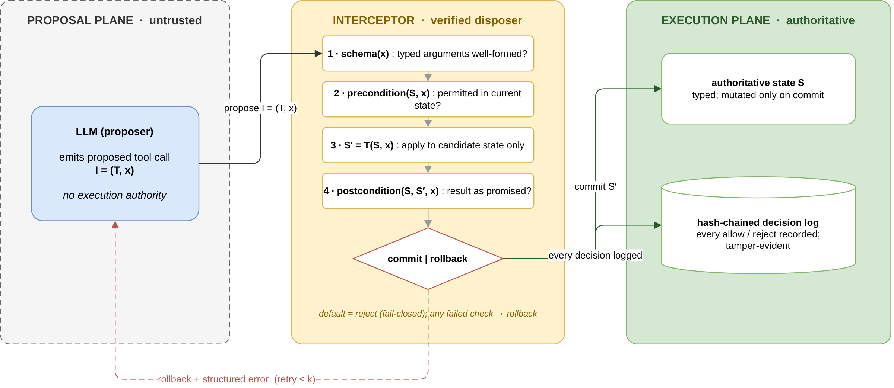

# updvd

[](https://doi.org/10.5281/zenodo.24443861)

Code and data for the paper "Model-Independent Blocking and Model-Dependent Substitution of LLM Agent Actions Under Runtime Contract" (NGISE 2026, to appear).

## What this is

updvd is a deterministic layer between an LLM agent and its tools that decides whether each proposed action may run. The model can only propose an action; the layer is the only part of the system that can change state. It is a research prototype that works on a simulated record store, not a production system.

The study keeps the layer fixed and swaps the proposing model across nine open models, to see whether the layer's guarantee depends on the model. All results in the paper come from this code, and `updvd reproduce` recomputes every number in the paper from the released data.

## How it works

Every proposed tool call goes through the checks below, and every decision is written to a decision log that anyone can verify.

**Proposal.** The model reads a plain-language task and returns one structured tool call (a tool name and typed arguments). It cannot execute anything itself.

**Schema check.** pydantic validates the call before any rule is checked. Malformed calls (wrong type, missing field, blank data, unknown tool) are rejected at this point and never reach the contract.

**Precondition.** The tool's contract is checked against the current state. Only a writer or an admin may create a record. An update must target a record that exists, is not deleted and belongs to the actor (or the actor is an admin). Only an admin may delete, and not a record that is already deleted. A failing call is rejected with a structured reason.

**Apply and postcondition.** The action is applied to a copy of the state, and the postcondition is checked on that copy. The real state only changes if the check passes, so a rejected call leaves it untouched. After a rejection the reason goes back to the model, which can fix the call and try again, up to the retry limit.

**Decision log.** Every decision, accepted or rejected, is appended to a log in which each entry carries the hash of the entry before it. Changing an earlier entry breaks the chain, and recomputing the hashes shows it. The log makes tampering detectable but does not prevent it.



## Structure

```
src/updvd/
  interceptor.py        the interceptor: schema, precondition, apply, postcondition
  contracts.py          per-tool preconditions and postconditions
  schemas.py            typed argument schemas
  state.py              the record store
  verdicts.py           the verdict types
  trace.py              append-only, hash-chained decision log
  engine.py             the propose, check, retry loop
  proposer.py           proposer interface and the scripted proposer
  ollama_proposer.py    live model proposer through Ollama
  tasks.py              the evaluation task set
  scenarios.py          the deterministic demo
  evaluation.py         metrics and the containment re-check
  multimodel.py         multi-model and multi-seed runs
  analysis.py           prints the result tables from saved JSON
  mmlu.py               records the MMLU scores
  reproduce.py          recomputes every number in the paper from results/ and checks it
  cli.py                command-line entry point
scripts/                the full paper run, the multi-seed and MMLU runners, and the figure builder
tests/                  behavioral tests, one claim per test
results/
  seeds/                one report per model
  seeds/logs/           per-task decision logs, one file per model and seed
  mmlu/                 MMLU scores plus the raw lm-evaluation-harness output per model
  env/                  the environment of each Colab session of the paper run
figures/                the paper's three figures (PDF)
model-digests.json      sha256 digest of every model used in the paper run
requirements-colab.*    pinned packages for the paper run on Colab
CITATION.cff            citation metadata
```

## How to run it

Python 3.10 or higher. The core needs only pydantic. The live model needs the Ollama client and a running Ollama server.

```
pip install -e ".[llm,dev]"
```

`llm` adds the Ollama client. `dev` adds pytest.

### Reproducing the paper

All results in the paper come from a single run of `scripts/run_all.sh` on Google Colab (Tesla T4 GPU, Python 3.12.13). The script will not start on a different GPU. Colab's default Python may be newer, so the script installs Python 3.12.13 into its own environment (`~/updvd-venv`) and runs everything there.

1. Open a new Colab notebook and choose Runtime > Change runtime type > T4 GPU.
2. Mount Google Drive and clone this repository there, so the results are kept if Colab disconnects. Use the URL from the green Code button on this repository's GitHub page in place of `<URL>`:
   ```
   from google.colab import drive; drive.mount("/content/drive")
   %cd /content/drive/MyDrive
   !git clone <URL> updvd
   %cd updvd
   ```
3. Log in to Hugging Face with an account that has accepted the Meta and Google licenses (several MMLU models are gated):
   ```
   from huggingface_hub import notebook_login; notebook_login()
   ```
4. Move the released results aside, then run everything. The script refuses to start while `results/` holds files from another run, so a new run is never mixed with the released one:
   ```
   !mv results results-released
   !bash scripts/run_all.sh
   ```

The script installs the package versions pinned in `requirements-colab.txt` and Ollama 0.32.5. It runs the behavioral experiment (nine models, seeds 0 to 4, temperature 0.7, at most three retries per episode), shuts Ollama down, runs MMLU for all nine models and finishes with `updvd reproduce`. If Colab disconnects, run step 4 again; models that already finished are skipped. The environment of each session (GPU, driver, Python, Ollama, `pip freeze`) is saved in `results/env/`.

A rerun gives exactly the published numbers only with the recorded setup, meaning the same Ollama release, model digests and GPU. On other setups the substitution rates will move within sampling noise. Blocking will not, because no model output can get a forbidden action past its contract. `updvd reproduce` recomputes every number in the paper from the released logs and gives the same output on any machine.

### Model versions

An Ollama tag can be updated to point at new weights, which happened to `gemma3:4b` after our first runs. `model-digests.json` lists the full sha256 digest of each model used in the paper run, and `updvd multiseed` stops if a pulled model has a different digest.

The paper run was itself a rerun of an earlier one on the same setup. 43 of its 45 decision logs (one per model and seed) are identical to the earlier run's. The two that differ are `gemma3:4b` seeds 1 and 4, after that tag had moved to new weights.

### Figures

```
pip install -e ".[figures]"
python scripts/make_figures.py        # reads results/, writes figures/*.pdf
```

The script builds the two data figures the paper uses, and nothing else:

- `figures/fig_seed_spread.pdf` (paper Fig. 2): the pooled substitution rate per model with its 95% Wilson interval, and the five single-seed rates
- `figures/fig_substitution_vs_mmlu.pdf` (paper Fig. 3): the substitution rate against MMLU accuracy, with Spearman's rho and its exact permutation p-value

Both are computed from `results/seeds/*.json` and `results/mmlu/mmlu.json`. The PDFs carry no creation date, so rebuilding from the released results gives byte-identical files. Fig. 1, the architecture diagram (`figures/fig_architecture.pdf`), is drawn by hand in draw.io and is not built by the script.

### Run modes

```
updvd demo                                      # deterministic walkthrough, no model
updvd eval --scripted                           # full evaluation with the scripted proposer
updvd multiseed --models qwen3:8b --seeds 0 1 2 3 4 --temperature 0.7 \
    --output results/seeds/qwen3-8b.json        # one model under the paper protocol
updvd analyze --results results                 # Tables 1 and 2, plus the table ordered by MMLU
updvd analyze --seeds-file results/seeds        # the multi-seed table
updvd reproduce                                 # every paper number, checked against the paper
```

`updvd multiseed` only runs with Ollama 0.32.5. Two commands do not follow the paper protocol and were not used for it: `updvd multimodel`, and `updvd eval` with a live model, which keeps one state across all tasks and uses temperature 0.

### Variation across seeds

`multiseed` runs the task set once per seed and reports the substitution rate in two ways: the mean across seeds with its population standard deviation, and the pooled rate with a 95% Wilson interval. The temperature has to be above zero. At temperature 0 decoding is greedy and every seed gives the same output, so extra seeds would tell us nothing. Blocking is reported in the same way. Each model gets its own JSON file in `results/seeds/`, and `updvd analyze --seeds-file results/seeds` combines them into one table.

### Capability axis (MMLU)

The paper uses MMLU rather than parameter count as its measure of capability. We measured the scores ourselves instead of taking them from model cards, with the same protocol for all nine models (set in `scripts/run_mmlu.py`):

- lm-evaluation-harness 0.4.12 with the `hf` backend, loading each model itself
- 0-shot, log-likelihood scoring of the answer options, no chat template
- a fixed 10% of each subject (n=1430 per model)
- 4-bit loading with only `load_in_4bit=True`, so the quantization is the bitsandbytes default (fp4)
- batch size 4, and the Python, numpy, torch and few-shot seeds all 1234

Each model's harness output is saved to `results/mmlu/<tag>/results.json`, and its `config` block records these settings. `results/mmlu/mmlu.json` collects the scores together with where each one came from. Once that file exists, `updvd analyze` adds an MMLU column and a table ordered by MMLU.

One model differs between the two measurements. At run time the Ollama tag `qwen3:4b` resolved to Qwen3-4B-Thinking-2507 (the server log in `results/env/session-20261025T140842/ollama-serve.log` records `general.name = Qwen3 4B Thinking 2507`), while MMLU was scored on the original `Qwen/Qwen3-4B`. The paper states this and reports the MMLU correlation both with and without qwen3:4b.

## What the demo run demonstrates

`updvd demo` runs a fixed script that triggers each behavior once. No model or seed is involved, so the output is always the same.

| Behavior | Decision-log signature |
|---|---|
| Valid create, committed | verdict ok, committed |
| Valid update, committed | verdict ok, committed |
| Schema violation, corrected and committed | first schema_violation, then committed |
| Ownership violation, corrected and committed | first ownership_violation, then committed |
| Authorization violation, blocked | authorization_violation, never committed |
| Referential violation, corrected and committed | first referential_violation, then committed |

## Output format

Each evaluation writes one compact JSON report per model under `results/seeds/`, plus the full per-task decision logs under `results/seeds/logs/`.

| Field | Description |
|---|---|
| generated | When the report was written |
| seeds | The sampling seeds run for every model |
| temperature | The sampling temperature used for the run |
| environment | Python version, platform, Ollama version, GPU and driver, package versions, the full sha256 digest of every model, and the model options (temperature, seeds, think off, JSON format, keep-alive, max retries). The recorded keep-alive was passed inside the model options, where Ollama ignores it (the server logs `invalid option provided option=keep_alive`), so the server default applied. It does not affect model output |
| models[].model | The model name |
| models[].digest | The exact model version that produced the run |
| models[].substitution | Substitution over the forbidden trials: pooled rate with its 95% Wilson interval, per-seed rates, and the across-seed mean and standard deviation, split by violated rule |
| models[].blocking | Blocking over the same trials: pooled rate with its 95% Wilson interval, and the leaked count (should be zero) |
| models[].per_seed | One row per seed: the forbidden-task counts that the pooled and across-seed figures are built from |
| overhead_ms | Checker time per action for each model, pooled over its seeds: number of actions, median (p50), mean, p99 and maximum |

With the `per_seed` block a reader can rebuild the pooled numbers from the per-seed counts. The report itself is kept small. The full decision log of every run (tool, arguments, verdict and committed action for each attempt) is in `results/seeds/logs/`, and `updvd reproduce` replays each logged proposal through the interceptor to confirm that it gets the same decisions and hashes.

## Decision-log integrity

```
entry_hash = SHA-256( canonical_json(seq, tool, args, verdict, detail, committed, prev_hash) )
```

The first entry's `prev_hash` is 64 zeros. `Trace.verify()` walks the log and compares each `prev_hash` with the recomputed hash of the entry before it, which catches an earlier entry being changed, removed or moved. The newest entry is only protected once its hash is stored somewhere else. The released logs store every hash, and `updvd reproduce` checks them. `containment_holds` replays the run from its starting state and confirms that each committed action still passes its contract.

## Tests

```
pip install -e ".[dev,figures]"
python -m pytest -q
```

The tests use the scripted proposer and the released results, so they need no GPU or Ollama. One of them runs `updvd reproduce` on `results/`, and one rebuilds the figures (it is skipped if matplotlib is not installed). Each test checks a single claim.

## What the results show

**Finding 1: blocking does not depend on the model.** Across 35 forbidden tasks per model, run under five seeds (175 trials per model), the forbidden action never ran for any model: nothing leaked through in any of the 1,575 trials, and in the 1,519 trials where the model proposed the forbidden action, the checker rejected it every time. The per-action check time was under 0.1 ms at the median (about 0.07 ms) for every model. Each result file stores it per model as `overhead_ms`.

**Finding 2: substitution varies widely, and no measured model property clearly predicts it.** Instead of the forbidden action, models often got a different, permitted action committed, at rates from 1.1% to 37.7%. Most of these 292 substitutions came after a rejection (251); the other 41 were committed on the first attempt, without the forbidden action being proposed. The distribution is continuous: ranked by substitution rate, no two adjacent models have non-overlapping 95% intervals, so the models do not fall into groups. Neither parameter count nor MMLU orders them: the 2B model substitutes 10.9% while a 4B model substitutes 1.1%, and qwen2.5:7b, the model with the highest MMLU, substitutes 22.9%, while phi4-mini scores seven and a half points lower and substitutes the most (37.7%). Across the nine models, the rank correlation between MMLU and substitution is ρ = 0.58 (exact permutation p = 0.11), which at this sample size cannot be told apart from no relationship. Excluding qwen3:4b, whose MMLU score comes from a different checkpoint (see Capability axis), gives ρ = 0.69 (p = 0.07, n = 8). With nine models the test has little power, so it can neither establish nor rule out a relationship. The layer bounds the action, not the intent.

| Model | MMLU | Blocking | Leaked | Substitution mean (sd) | Pooled rate [95% CI] |
|---|---|---|---|---|---|
| gemma3:4b | 55.17 | 175/175 | 0 | 1.1% (1.4) | 1.1% [0.3, 4.1] |
| gemma2:2b | 55.24 | 175/175 | 0 | 10.9% (2.8) | 10.9% [7.1, 16.3] |
| llama3.2:3b | 60.98 | 175/175 | 0 | 3.4% (1.1) | 3.4% [1.6, 7.3] |
| phi4-mini | 63.08 | 175/175 | 0 | 37.7% (5.8) | 37.7% [30.9, 45.1] |
| qwen3:4b | 64.41 | 175/175 | 0 | 25.7% (2.6) | 25.7% [19.8, 32.7] |
| llama3.1:8b | 65.03 | 175/175 | 0 | 15.4% (2.3) | 15.4% [10.8, 21.5] |
| phi3:mini | 67.90 | 175/175 | 0 | 14.9% (7.8) | 14.9% [10.3, 20.9] |
| qwen3:8b | 69.58 | 175/175 | 0 | 34.9% (2.8) | 34.9% [28.2, 42.2] |
| qwen2.5:7b | 70.63 | 175/175 | 0 | 22.9% (5.1) | 22.9% [17.3, 29.6] |

Rows are ordered by MMLU. The mean and standard deviation are across the five seeds; the pooled rate and its 95% Wilson interval are over all 175 trials per model. Full-precision values and per-seed counts are in `results/seeds/*.json`, the per-task decision logs in `results/seeds/logs/`, and the raw harness output under `results/mmlu/<tag>/`.

## Limitations

This prototype shows the interceptor logic and the gap between action and intent. It does not measure detection accuracy or performance under load. All tasks come from one domain (record operations), and the way models substitute, usually by falling back to creating a record, is tied to this tool set. The substitution numbers come from five seeds at a single temperature (0.7). That is not enough to settle the order of models with similar rates, and one temperature covers only a small part of the sampling behavior. The 175 trials per model are 35 tasks repeated under five seeds, so they are not independent; the Wilson intervals treat them as independent and are therefore optimistic. Across 675 correctable trials the first call was rejected only eight times (seven malformed calls and one ownership violation), so the data says little about recovery from errors. Only the temperature was fixed across models; the other sampling parameters (top-k, top-p, repeat penalty) were each model's Ollama defaults and differ between models. The two measurements also use different quantizations of the same model releases (except qwen3:4b, see Capability axis), bitsandbytes 4-bit for MMLU and Ollama GGUF for the behavioral runs, although both ran on Tesla T4 GPUs on Google Colab. MMLU is scored without a chat template, so it measures each instruction-tuned model in completion mode, while the behavioral runs use the chat interface; we use MMLU only to compare the models with each other.

## How to cite

If you use this code or data, please cite the paper:

Salmanov, P.: Model-Independent Blocking and Model-Dependent Substitution of LLM Agent Actions Under Runtime Contract. In: NGISE 2026. Springer (to appear).

```
@inproceedings{salmanov_updvd,
  author    = {Salmanov, Parviz},
  title     = {Model-Independent Blocking and Model-Dependent Substitution of {LLM} Agent Actions Under Runtime Contract},
  booktitle = {NGISE 2026},
  publisher = {Springer},
  year      = {2026},
  note      = {To appear}
}
```

The code and data of this release are archived on Zenodo at https://doi.org/10.5281/zenodo.24443861. To cite them directly, use the "Cite this repository" button on GitHub, which reads `CITATION.cff`.

## Author

Parviz Salmanov, Tallinn University of Technology

## License

MIT License. See [LICENSE](LICENSE).
